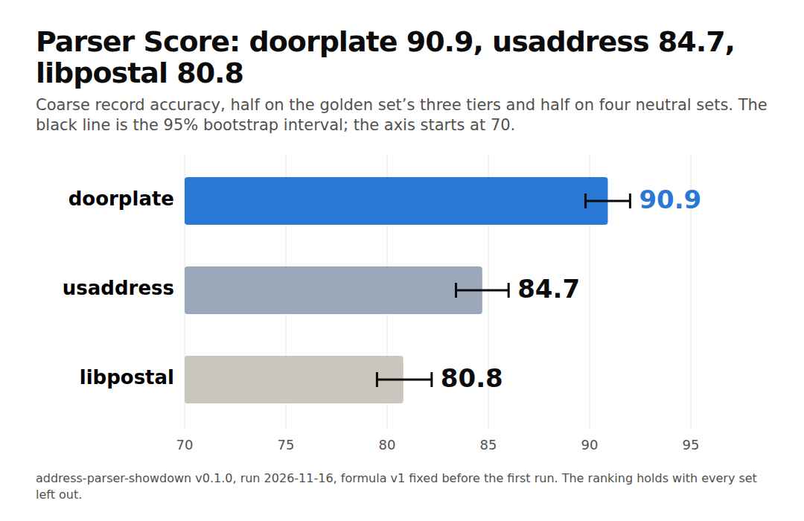
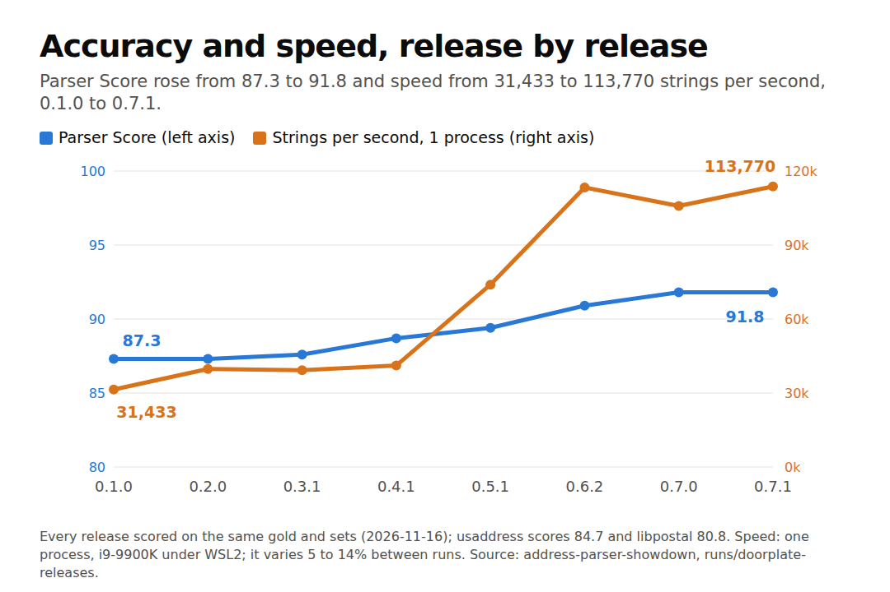
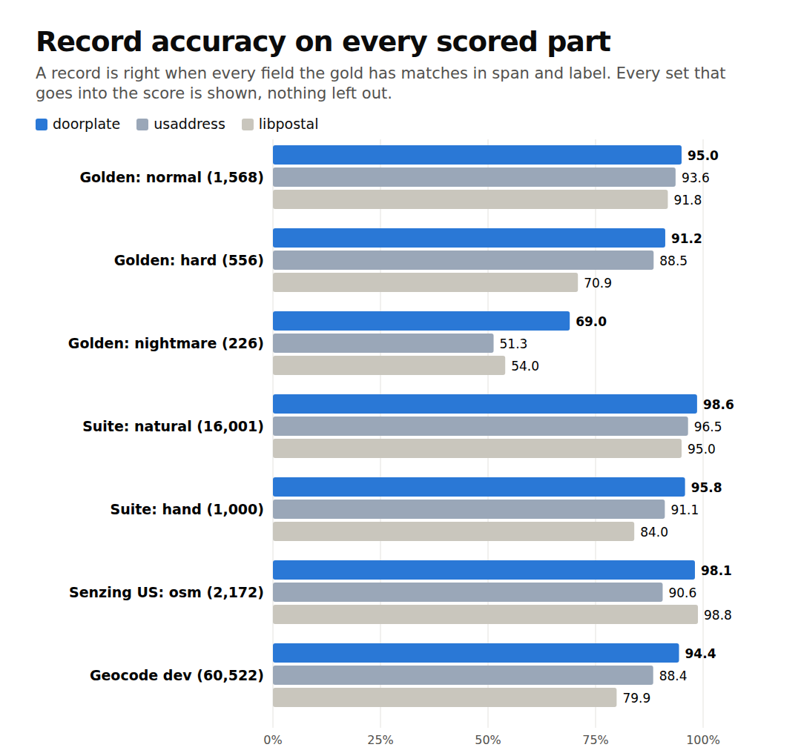

# Towards Data Science article: draft for the owner

## Notes for the owner (delete before submitting)

- **Checked against the TDS submission guidelines (pasted 2026-11-23).** What the draft now does, and what is left to
  you:
  - *Title and subtitle:* a short title with a longer subtitle under it, no capitals-only words.
  - *Message up front:* the introduction states the idea, why it matters and how the article proves it (three claims, a
    benchmark). Counter-arguments are answered in the text (the conflict of interest, the AI section).
  - *Facts and sources:* every dataset and outside work is linked at first mention and listed under "References" in
    their format (`[N] N. Name, Title (Year), Source`). Years were checked on GitHub and arXiv; libpostal's is its first
    release (2016).
  - *Conclusion, not promotional:* the last section is now "Conclusion: should you switch?", opening with a summary of the
    three claims. The bug-report request and the separate install block are gone (they read as a call to action); the
    install command and the demo stay in one sentence.
  - *Original work (point 12), your decision:* TDS asks that the article be "entirely your own original work" and that you
    be "the sole creator of each and every element". This draft was written by an AI assistant from your project
    material. The pasted guidelines do not mention AI-written text, but the Author Terms and Conditions (not read) may.
    Rewrite it in your own words, or at least read the Author Terms and ask the editors before submitting. The article's
    disclosure covers the code, not the text.
  - *Data rights (point 11), your decision:* TDS is commercial and asks you to confirm each dataset permits commercial
    use. Neither dataset is in the doorplate software or package, and the article says so: only benchmark scores appear, and
    no records are shown. Both are cited ([3] Yin, Li and Goldberg, arXiv:2310.14360, whose repository states **no
    license**; [4] Senzing/libpostal-data, mixed provenance) and the rights are as stated in those citations. Forward any
    permission to publication@towardsdatascience.com. usaddress's and libpostal's test data are MIT; the golden set is public records
    plus invented strings. The 290 million rows are counts only.
  - *Images (point 10):* three of your own charts from `site/_social/showdown/` (#866, the 0.7.1 run), each captioned
    "Image by author": `score.png` (Parser Score with intervals) as the featured image, `parts.png` in the results, and
    `history.png` in "Claim 2". They are linked by relative path (`../showdown/`); upload them in the TDS form and
    replace the links.
  - *Code:* code blocks, not screenshots, each with text around it. OK.
  - *Originality and timing:* publishing on TDS first gives the best chance of being featured, so keep it off the project
    blog and Medium until TDS answers.
  - *Also yours:* a real-name author profile with a photo and bio; precise tags (suggested: Python, Data Engineering,
    Open Source, Rust, Data Cleaning); feedback from a friend before you submit.
- **Disclosure.** The article says up front that you wrote doorplate and the showdown, and that you built doorplate with
  an AI coding assistant. The section "How it was built with AI, and why it is not AI slop" takes its points and figures
  from issue #865 (the figures comment and the "case against AI slop" draft, both 2026-11-23), including your own account
  of how you review the code and the two mistakes. Word it the way you want, but keep the disclosure and the mistakes in.
  The guidelines ask you to answer counter-arguments, and this section does that for the most common one in 2026.
- **Figures.** Every figure is from the showdown's pinned run of 2026-11-23 (`report/REPORT.md`, doorplate 0.7.1,
  usaddress 0.5.16, libpostal with the Senzing model) or from `docs/dataframes.md` (the `parse_many` batch figures, 0.7.0
  release candidate, 4 CPUs). The code blocks were run on 2026-11-23 against the current build (0.7.2-dev, which parses
  as 0.7.1); every address in them is invented. The project figures in the AI section (commits, tests, CI runs, review
  verdicts, fuzzing) are from issue #865, measured 2026-11-23; the three-and-a-half-to-six-and-a-half-year figure is
  that issue's bottom-up estimate, not a measurement.
- **Length:** about 3,100 words (code blocks and references included) without these notes. The pasted guidelines set
  no limit.
- **Title** (chosen by you, 2026-11-23; the subtitle stays as written): "Parsing US Addresses Without a Model"
  3. "Replacing usaddress With One Import"

---

# Parsing US Addresses Without a Model

*I built a US address parser from hand-written rules instead of a trained model, then benchmarked it against usaddress
and libpostal. Here is how far its claims of compatibility, speed and accuracy hold, and where it still loses.*


*Image by author*

If you have worked with US address data, you have probably used [usaddress](https://github.com/datamade/usaddress) [1].
DataMade's library takes a string like `123 N Main St Apt 4, Miami FL 33101` and labels each token: the house number,
the street name, the suffix, the unit, the city. It is the default choice in Python, and for good reason: it is small,
easy to install and usually right.

Over the past five weeks I built a replacement called [doorplate](https://github.com/jeremeybingham/doorplate).
doorplate is a US address parser written in Rust, with a Python package and a command-line tool. This article is about three
claims I want to make for it, and how far each one holds:

1. **It is a drop-in replacement for usaddress**, for code that calls `parse` and `tag`.
2. **It is faster**: about 13 times faster than usaddress from Python, in one process.
3. **It is more accurate**, by a lot on messy and unusual addresses and by a little on ordinary ones.

A disclosure first: I wrote doorplate, and I also built the benchmark the accuracy figures come from. I'll describe
how the benchmark guards against that bias and where it can't. I also built doorplate with an AI coding assistant, which
did most of the typing. I made the design decisions, labeled the test data and reviewed the results on real addresses;
how that worked has its own section near the end.

## Why another address parser?

Address parsing sounds like a solved problem until you run a real file through it. Public-records exports, mailing
lists and web forms contain things like:

- `RR 3 BOX 12`, a rural route, not a street
- `PSC 1650 BOX 10, APO AE 09173`, a military address
- `CALLE LUNA 123`, a Puerto Rico address with the house number after the street
- `123 OAKBLVD`, two words with the space lost
- units in odd places, units written twice, and cities that start with a compass word (`S Elgin`)

usaddress is a conditional random field (CRF), a statistical model trained on labeled examples. libpostal [2], the other
common choice, is also a CRF, trained on OpenStreetMap and OpenAddresses data. Both are good at the shapes they were
trained on. When they get something wrong, the fix is to add training data and retrain, which few users do.

doorplate takes the opposite approach: **hand-written rules plus a list of place names**, with no learned model. Every
rule cites its source (USPS Publication 28 [5] where one exists), and every misparse that gets fixed becomes a test case.
That has costs: someone has to write the rules, and a rule can only handle shapes someone has seen. It also has
benefits:

- **It is predictable.** The same input gives the same output, and you can read why.
- **A misparse can be fixed.** A bug report becomes a rule or a line of data, not a retraining job.
- **It is small and fast.** No model to load: the Python wheel has no runtime dependencies and uses about 25 MB of
  memory after loading, against about 3 GB for libpostal.

It does more than label tokens. It also standardizes to USPS Publication 28 and RESO formats, builds a match key for
deduplication, and reports warnings when the input looks wrong. More on the key below.

One thing it does **not** do is validate. doorplate tells you how an address is written, not whether it exists or can
receive mail. Validation needs postal-service-certified data, and no parser gives you that.

## Claim 1: drop-in compatibility with usaddress

Most usaddress code calls one of two functions: `parse`, which returns `(token, label)` pairs, or `tag`, which returns
a dictionary of labeled parts and an address type. doorplate ships a compatibility module with the same functions, the
same label names and the same exception:

```python
import doorplate.compat as usaddress    # was: import usaddress

parts, kind = usaddress.tag("PO Box 12, Tampa FL 33601")
tokens = usaddress.parse("PO Box 12, Tampa FL 33601")
# [('PO', 'USPSBoxType'), ('Box', 'USPSBoxType'), ('12,', 'USPSBoxID'),
#  ('Tampa', 'PlaceName'), ('FL', 'StateName'), ('33601', 'ZipCode')]
```

The rest of the script stays as it was. The tokens are cut the same way as `usaddress.parse`: I checked them token by
token against usaddress's own tokenizer on the 8,108 in-scope strings of its test files and on 56,835 benchmark inputs,
and found no difference. `tag_mapping` works as before, so code that renames labels (`PlaceName` to `City`) keeps
working.

"Drop-in" has limits, and you should know them before you switch:

- **A token doorplate cannot place gets the label `None`.** usaddress labels every token. Code that calls a string
  method on every label needs a guard.
- **Intersections are not modeled.** `Main St & 1st Ave` never comes back as the `Intersection` type; the second street
  is reported as unparsed text with a warning.
- **A repeated label does not raise by default.** usaddress raises `RepeatedLabelError` when a label appears in two
  separate runs. doorplate joins the runs instead, and raises only when you pass `strict=True`, so an existing
  `try/except` keeps its meaning if you ask for it. On the 8,108 strings of usaddress's test files, usaddress raises on 5
  and doorplate (with `strict=True`) on none.
- **There is no model to retrain**, so `tokenize`, `TAGGER` and the training tools are not provided.
- **Some labels differ at the edges.** A parser built from rules and a parser built from a model disagree on rare
  shapes. For example, usaddress labels the `PSC 1650` in a military address as a subaddress, and doorplate labels it as
  a box group.

So it is label compatibility, not identical output. For most scripts that is a one-line change. If you are on a
pipeline that depends on exact labels for unusual shapes, run both on a sample of your data and compare first.

## Claim 2: faster

All of the timings below come from one machine (an Intel Core i9-9900K under WSL2, limited to 4 CPUs) in the
benchmark's pinned run. Read the ratios, not the digits: they move between sessions.

| Calling it from Python, one process | Strings per second | Memory after loading |
|---|---|---|
| doorplate 0.7.1 | about 117,000 | 25 MB |
| libpostal (Senzing model) | about 15,600 | about 3 GB |
| usaddress 0.5.16 | about 9,000 | 27 MB |

That is about 13 times faster than usaddress and 7 times faster than libpostal, in a plain loop of single calls. The
parse itself takes about 6 microseconds in Rust; the rest of each call is the cost of crossing into Python.

For batches, `parse_many` releases Python's global interpreter lock (GIL) and parses in parallel across cores. On
100,000 addresses with 4 CPUs:

| Method | Time | Per second |
|---|---|---|
| a loop of `parse` | 0.74 s | 135,000 |
| `parse_many` | 0.29 s | 345,000 |
| DuckDB, `doorplate_parse(address)` with 7 columns | 0.29 s | 341,000 |
| pandas or Polars `parse_column`, 15 columns | 0.46 to 0.59 s | 170,000 to 216,000 |

(These batch figures are from the 0.7.0 release candidate; 0.7.1 parses identically and slightly faster.) At these
speeds, `parse_many` would get through 10 million addresses in about 30 seconds on 4 CPUs, where a loop of usaddress
calls would take about 20 minutes (estimated from the rates above, not timed).

Both numbers improved release by release. Scoring every release on the same data, the Parser Score rose from 87.3
(0.1.0) to 91.8 (0.7.1), and single-process speed from 31,433 to 113,770 strings per second.


*Image by author*

## Claim 3: more accurate

This is the claim that needs the most care, so here is how it was measured.

### The benchmark

I built an open benchmark, [address-parser-showdown](https://github.com/jeremeybingham/address-parser-showdown), to
compare doorplate, usaddress and libpostal on equal terms. Because each parser uses its own labels, each one is read
through an adapter into one neutral schema of eight fields (house number, street, unit, PO box, route, city, state,
ZIP). A record counts as right only when every field matches the hand label in both span and label.

The data:

- **A new hand-labeled golden set** of 2,439 records in three tiers: `normal` (1,568), `hard` (556) and `nightmare`
  (226). Most came from public records drawn at random; the rest are invented strings of rare and typo shapes. No parser
  was run on any candidate before it was labeled. Every record was checked against doorplate's tests, usaddress's
  training files, libpostal's test sources and the geocode benchmark, so that no parser had seen it. libpostal's
  training data could not be checked.
- **Four outside sets**, scored as neutral parts. These include the `dev` split (60,522 one-line addresses) of the
  geocoding address-parsing benchmark of Yin, Li and Goldberg ([arXiv:2310.14360](https://arxiv.org/abs/2310.14360)) [3],
  and the US rows of Senzing's libpostal test data [4]. Neither dataset is part of doorplate or its package: only the
  benchmark scores computed on them are published, and the rights to the data are as stated in the two citations.
- **Each parser's own test files**, reported separately, since every parser does best on its own tests.

The headline is a **Parser Score**: coarse record accuracy, half from the golden set's three tiers and half from the
neutral parts. I fixed the formula before the first run.

### The results

| | doorplate | usaddress | libpostal |
|---|---|---|---|
| **Parser Score** (95% bootstrap interval) | **91.8** (90.7 to 92.9) | 84.7 (83.4 to 86.0) | 80.8 (79.5 to 82.2) |
| Golden, `normal` tier | 94.9% | 93.6% | 91.8% |
| Golden, `hard` tier | 92.4% | 88.5% | 70.9% |
| Golden, `nightmare` tier | 73.0% | 51.3% | 54.0% |
| Geocode benchmark `dev` (60,522) | 94.4% | 88.4% | 79.9% |
| Senzing US rows (2,172) | 98.1% | 90.6% | **98.8%** |

The ranking holds in every sensitivity check: with equal weights, and with each set left out in turn.

What the numbers say, and what they don't:

- **On ordinary addresses, the three parsers are close.** On the golden set's random public stratum (829 real address
  lines), doorplate gets 93.7%, usaddress 93.0% and libpostal 91.3%. The gap between doorplate and usaddress there is not
  statistically significant (exact McNemar test, p = 0.29). If your data is clean, accuracy is not a reason to switch;
  speed might be.
- **The gap is on hard data.** Most of the spread comes from rarer shapes: rural routes, military lines, units in odd
  places and typos. On the nightmare tier, doorplate is right on 73% and the others on about half. Real exports have a
  long tail of these, and they are often the records you most need to get right.
- **doorplate does not win everywhere.** libpostal is slightly ahead on the Senzing set built from OpenStreetMap, and
  usaddress and libpostal each lead on their own test files.


*Image by author*

### The conflict of interest

I wrote the parser, built the benchmark and labeled the golden set, so the benchmark could favor doorplate in ways I
can't see. What I did about it:

- The scoring formula and the labeling conventions were fixed before the first run, and every later change is logged
  with its effect (none changed the ranking).
- Half of the score comes from outside sets I did not label.
- The geocode benchmark's `test` split is left out entirely, because I read it while writing doorplate's rules.
- Every prediction file is published, so anyone can rescore the run or check a single record.

What it doesn't cover: the hand labels are still mine, and one of the four neutral sets (doorplate's own benchmark suite)
was built by me too. Leaving that set out lowers all three scores but keeps the order (89.9, 81.7, 77.9). The full method
is in the [report](https://github.com/jeremeybingham/address-parser-showdown/blob/main/report/REPORT.md) [6]. If you think
the method is unfair to usaddress or libpostal, I'd like to hear how.

## Beyond parsing: a key for deduplication

A common reason to parse addresses is to find the same place written two ways. doorplate builds a canonical **match
key** that ignores case, punctuation and abbreviation:

```python
import doorplate

doorplate.parse("123 N. Main St #4, miami, fl 33101").key()
# 'k6:S|123|N|MAIN|ST||FL|33101'
doorplate.parse("123 north main street apt 4, Miami FL 33101").key()
# 'k6:S|123|N|MAIN|ST||FL|33101'
```

`key()` identifies the property. A second key, `key_unit`, includes the unit, for when apartment 4 and apartment 5 must
stay apart. The `k6:` prefix is the key version: store it with your keys, because a later version may change them.

The same thing works in SQL. With DuckDB, deduplicating a table takes one query:

```python
import duckdb
from doorplate import duckdb as dd

con = duckdb.connect()
con.sql("""CREATE TABLE addresses AS SELECT * FROM (VALUES
  (1, '123 N. Main St #4, miami, fl 33101'),
  (2, '123 north main street apt 4, Miami FL 33101'),
  (3, 'PO Box 12, Tampa FL 33601'),
  (4, 'P.O. Box 12 Tampa, Florida 33601')) t(id, address)""")

dd.register(con, columns=["key"])
con.sql("""
  SELECT doorplate_parse(address).key AS key, count(*) AS n, list(id) AS ids
  FROM addresses GROUP BY key ORDER BY key
""").show()
```

```
┌──────────────────────────────┬───────┬─────────┐
│             key              │   n   │   ids   │
├──────────────────────────────┼───────┼─────────┤
│ k6:P|12|FL|33601             │     2 │ [3, 4]  │
│ k6:S|123|N|MAIN|ST||FL|33101 │     2 │ [1, 2]  │
└──────────────────────────────┴───────┴─────────┘
```

There are matching helpers for pandas and Polars (`parse_column`), and a command-line tool that adds parsed columns to
a CSV without any Python (`doorplate parse-file in.csv --column address -o out.csv`).

## How it was built with AI, and why it is not "AI slop"

A fair question about any project built this fast with an AI assistant is whether anyone checked it. In 37 days
doorplate had about 1,200 commits and 490 pull requests. That is not a human pace, and "a lot of code nobody really
read" is exactly what people mean by AI slop. So here is what the code had to pass before it was kept, and what I did
myself.

First, an irony worth stating: **the parser built with AI is the only one of the three with no learned model in it.**
usaddress and libpostal are statistical models. doorplate is deterministic rules. When it gets an address wrong, the
cause is a rule you can name, test and change, and every rule cites its source.

**Nothing merged on the assistant's word.** The checks were what made the pace possible:

- Every pull request ran the formatter, the linter with warnings as errors, and the full test suite: 264 Rust tests,
  345 Python tests and 1,530 expected-output cases, about 1,100 CI runs in all. Every fixed parsing bug became a new case.
- Every rule change was measured before the pull request was opened. The match keys of seven real sources (36.9 million
  rows) were compared before and after the change, and the pull request had to quote how many changed.
- I checked the output, not just the code: about 8,000 verdicts on real addresses where the parsers disagreed, plus the
  5,055 records I labeled for the benchmark. No model graded its own work there.
- "Never panic on input" is a project rule, enforced by a property test and fuzzing. Before release, about 370 million
  fuzzed inputs over five hours produced no crash. The core library has no `unsafe` code.

**Why AI at all: the size of the rule set.** Addresses come in thousands of shapes, and each rule has to handle its
shape without disturbing any other. doorplate has 229 rule issues, each measured against those 36.9 million keys. Keeping
a set like that consistent by hand is why open source has mostly used trained models instead. My rough estimate is that
one experienced developer would need three and a half to six and a half years to do this work alone. More honestly, one
person would not have done it more slowly; they would have skipped most of the checking. No one measures every rule on
37 million rows by hand. What the assistant changed is how much checking one person can afford.

**What I decided, and what I did not do.** The decisions that shape the project were mine, and several went against the
easy path: doorplate parses but does not validate; the match key is a versioned contract that is never edited in place;
features that worked were removed when they no longer fit; rule work stopped at the beta, when each remaining issue
affected only a few thousand rows. I write Rust, and I read the changes of individual pull requests and parts of the
code at random, but I have not read all of it, and I could not maintain it alone without the same tools. My review
works mostly through behaviour (real data, measured diffs, labeled records), with spot reads of the code. I think that is
the honest description, and a stronger one than claiming to have read everything.

**The mistakes got through at first.** An AI-written rule once broke the never-panic rule. The property test caught it,
but only about one run in ten, and the assistant first recorded the failure as "already present" instead of stopping.
Another rule, tuned on one benchmark, broke spelled-out directions such as `MAIN ST NORTH` elsewhere; that is why every
rule is now measured on all seven sources. The checks caught both. That is the point of having them.

## Conclusion: should you switch?

Each of the three claims holds, within limits. The compatibility module replaces `usaddress` with one import, but its
labels can differ on rare shapes. The speed gain is large and easy to reproduce. The accuracy gain is clear on messy and
unusual addresses and too small to measure on clean ones. Building with rules instead of a model costs a lot of rule
writing, and an AI assistant is what made that possible for one person. In return, every answer can be traced to a rule
and every rule to a source.

- **Yes, probably**, if you parse large files and speed matters, if your data is messy (public records, mailing lists,
  free-text forms), or if you need standardized output or a dedup key and have been building those yourself.
- **Test first** if your pipeline depends on exact usaddress labels for rare shapes, or on intersections.
- **No**, if you need addresses outside the US (libpostal covers the world) or need to know an address is deliverable
  (that takes a validation service).

doorplate is in beta: from version 0.7 the API and warning codes are stable. Its rules have been tested on about 290
million rows of public records, but your data will have shapes mine doesn't. The fastest way to find out is to run both
parsers on a sample of your own file. The package is `pip install doorplate`, and the
[in-browser demo](https://jeremeybingham.github.io/doorplate/demo/) runs on your machine, so no address leaves it.

*doorplate is open source under the MIT or Apache 2.0 license. Code: [github.com/jeremeybingham/doorplate](https://github.com/jeremeybingham/doorplate).
Documentation: [doorplate.readthedocs.io](https://doorplate.readthedocs.io/en/latest/). Benchmark and report:
[address-parser-showdown](https://github.com/jeremeybingham/address-parser-showdown). All images are by the author.*

## References

[1] DataMade, [usaddress](https://github.com/datamade/usaddress) (2014), GitHub

[2] A. Barrentine, [libpostal](https://github.com/openvenues/libpostal) (2016), GitHub

[3] Z. Yin, D. Li and D. W. Goldberg, [Is ChatGPT a game changer for geocoding: a benchmark for geocoding address
parsing techniques](https://arxiv.org/abs/2310.14360) (2023), ACM SIGSPATIAL GeoSearch Workshop 2023; data at
[zhengcongyin/geocoding-address-parsing-benchmark](https://github.com/zhengcongyin/geocoding-address-parsing-benchmark)

[4] Senzing, [libpostal-data test data v1.2.0](https://github.com/Senzing/libpostal-data) (2025), GitHub

[5] United States Postal Service, [Publication 28: Postal Addressing Standards](https://pe.usps.com/text/pub28/welcome.htm)
(online edition, read October 2026), USPS

[6] J. Bingham, [address-parser-showdown: report](https://github.com/jeremeybingham/address-parser-showdown/blob/main/report/REPORT.md)
(2026), GitHub
